

  

[English](README.md) | **Français** | [Русский](README.ru.md) | [Español](README.es.md) | [中文](README.zh.md)

  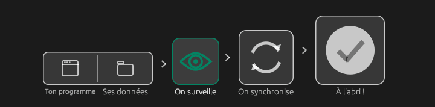

Tes sauvegardes et réglages de jeux et de logiciels, protégés et synchronisés entre tous tes appareils : PC fixe, portable, console portable (Legion Go S, Steam Deck...). Tu reprends ta partie là où tu l'as laissée, tu retrouves tes configurations logicielles où que tu sois. Tout passe par **ton coffre** : n'importe quel dossier partagé que tes appareils voient tous (Google Drive, OneDrive, Dropbox, Nextcloud, Syncthing, un NAS, une clé USB...). Gratuit pour un usage personnel, Windows et Linux.

[**Télécharger la dernière version**](https://github.com/Epikou/AutoGameSoftwareSync/releases/latest) · [Soutenir le projet sur Ko-fi](https://ko-fi.com/autogamesoftwaresave)

## Comment ça marche

  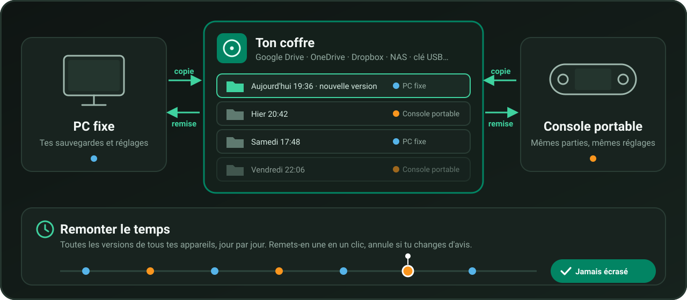

1. L'appli tourne sur chacun de tes appareils et surveille les jeux et logiciels que tu protèges.
2. Quand tu arrêtes de jouer, une copie part dans **ton coffre**. Chaque copie est une **nouvelle version** : rien n'est jamais écrasé.
3. Sur tes autres appareils, la version la plus récente est remise toute seule : tu reprends là où tu t'étais arrêté.
4. Toutes les versions restent dans le coffre : **remonte le temps** quand tu veux.

## Fonctions clés

### Tout d'un coup d'œil

Une tuile par jeu, logiciel ou dossier, avec son état (« À l'abri · il y a 2 min », « Copie… 64 % », « Nouvelle version de Handheld ») et où il est à jour parmi tes appareils.

  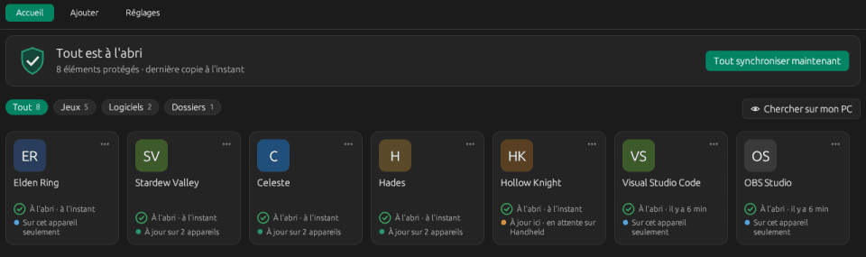

### Remonter le temps

Une frise jour par jour de toutes les versions de tous tes appareils. Tu remets la version d'hier en un clic, et tu **annules** si tu changes d'avis : une copie de sécurité est toujours faite avant.

  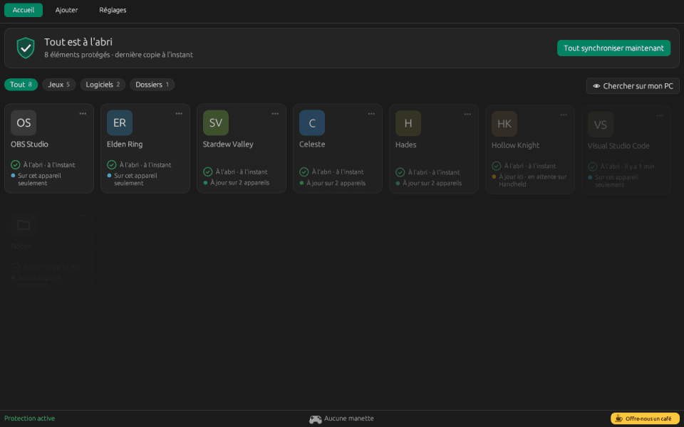

### Il repère tes jeux quand tu joues

Lance un jeu : l'appli le reconnaît et propose de le protéger. Un clic sur **Synchronise-le !** et il rejoint ton accueil. Tes outils en ligne de commande ne sont jamais proposés.

  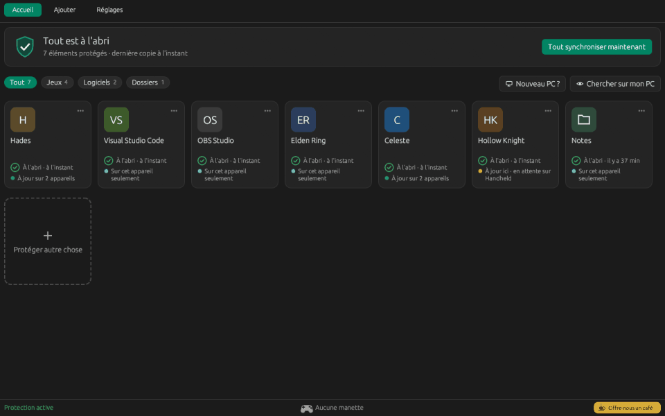

### Un premier lancement qui configure vraiment

6 étapes courtes (langue, coffre, cet appareil, scan, autre chose, première copie), puis tout se fait tout seul.

  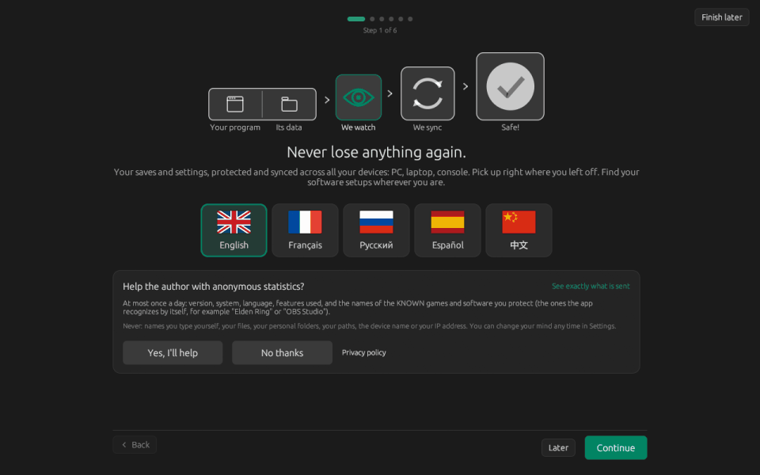

### Nouveau PC : tout récupérer

Choisis ton ancien appareil, vérifie, récupère. Fonctionne avec un autre nom d'utilisateur et de Windows vers Linux ; un jeu pas encore installé est récupéré dès qu'il apparaît.

  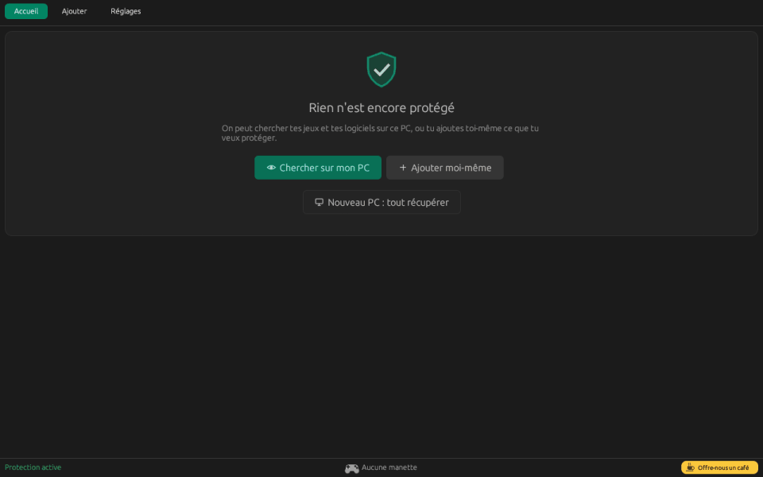

### Et aussi

- **Ton coffre est trouvé tout seul** : Google Drive, OneDrive, Dropbox, iCloud, MEGA, pCloud, Nextcloud, Syncthing, disques réseau et USB. Un coffre que tu utilises déjà (sur un autre appareil, ou avec une ancienne version) est proposé en premier.
- **Scan du PC** : tes jeux (Steam, Epic, GOG, Xbox, Ubisoft, EA, itch, émulateurs), tes logiciels, tes dossiers perso et tes raccourcis Windows. Ce qui est sûr est coché, le reste est proposé ; les outils de développement et les programmes du système ne sont jamais proposés.
- **Mises à jour automatiques et vérifiées** : signées par l'auteur, installées au moment calme, et l'ancienne version revient toute seule si quelque chose se passe mal.
- **Simple par défaut, expert si tu veux** : des mots simples et 6 cartes de réglages ; le mode expert garde toutes les options techniques.
- Ne perd jamais de données : chaque copie est un nouveau dossier, les anciennes versions sont gardées, rien n'est jamais écrasé dans ton coffre.
- Navigation complète à la manette, grand format pour les consoles portables, thèmes sombre et clair. Langues : English, Français, Русский, Español, 中文.

## Captures d'écran

| | |
|---|---|
| 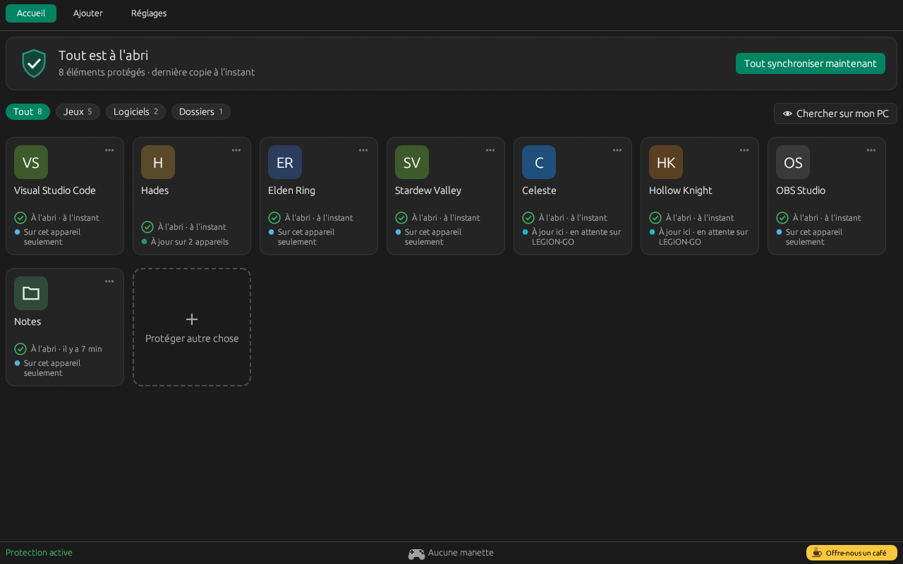 | 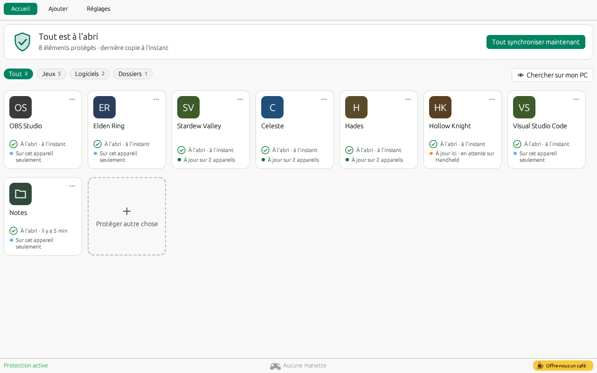 |
| 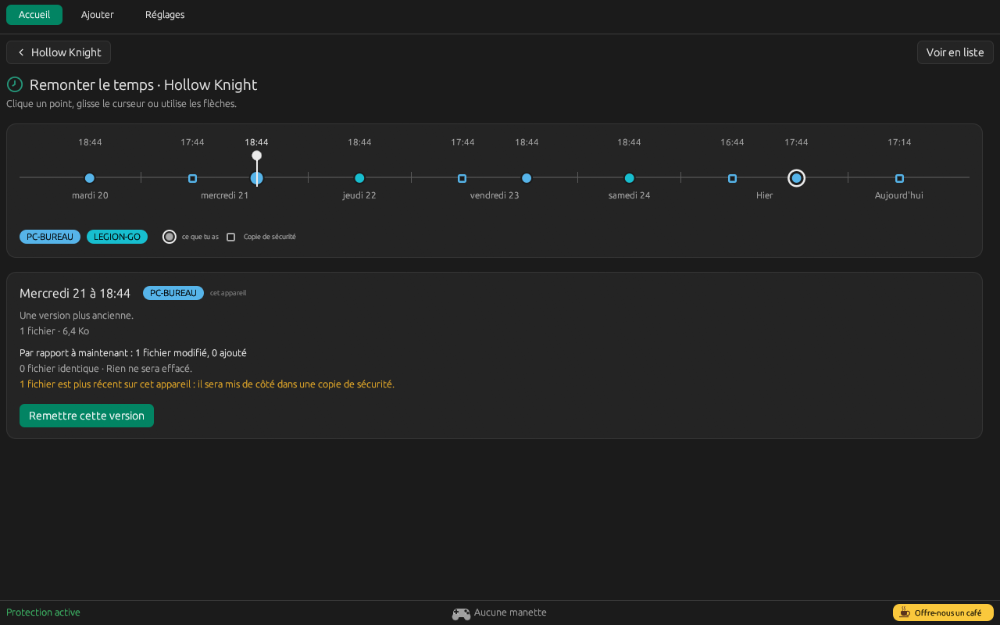 | 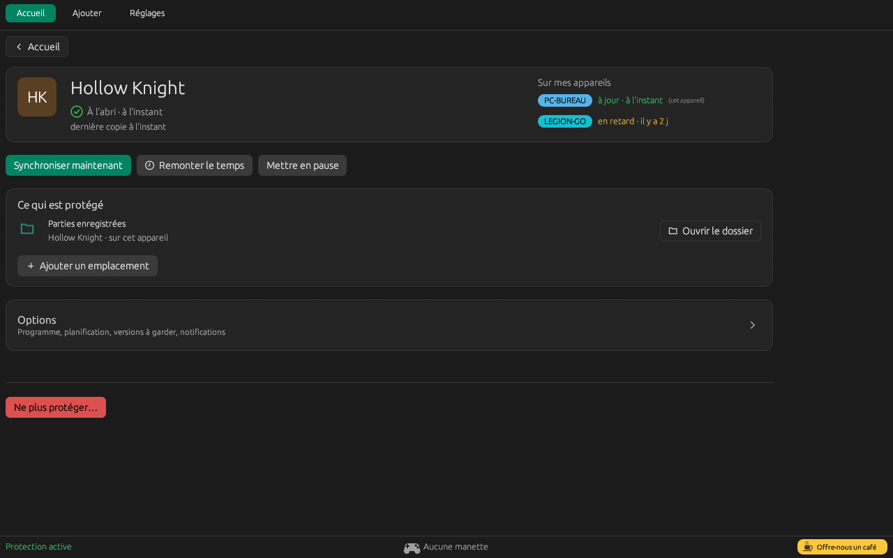 |
| 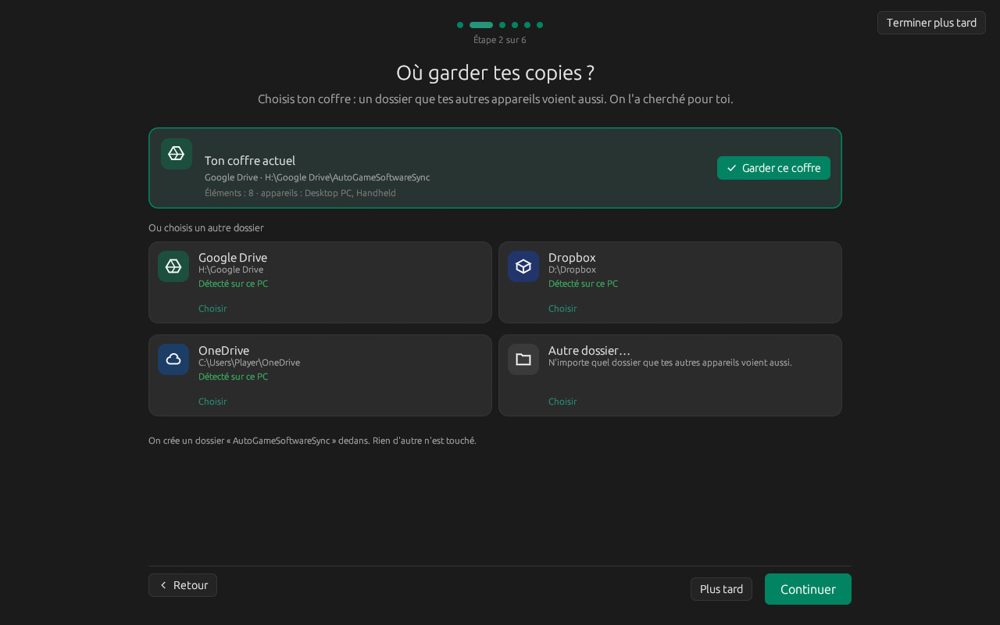 | 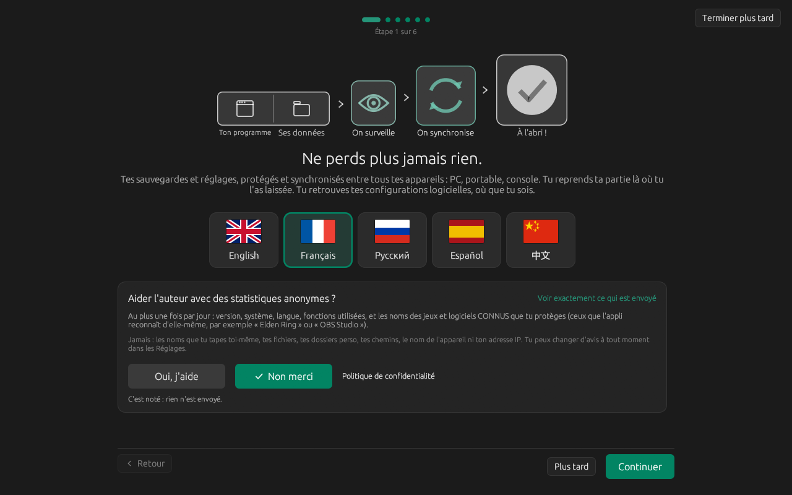 |
| 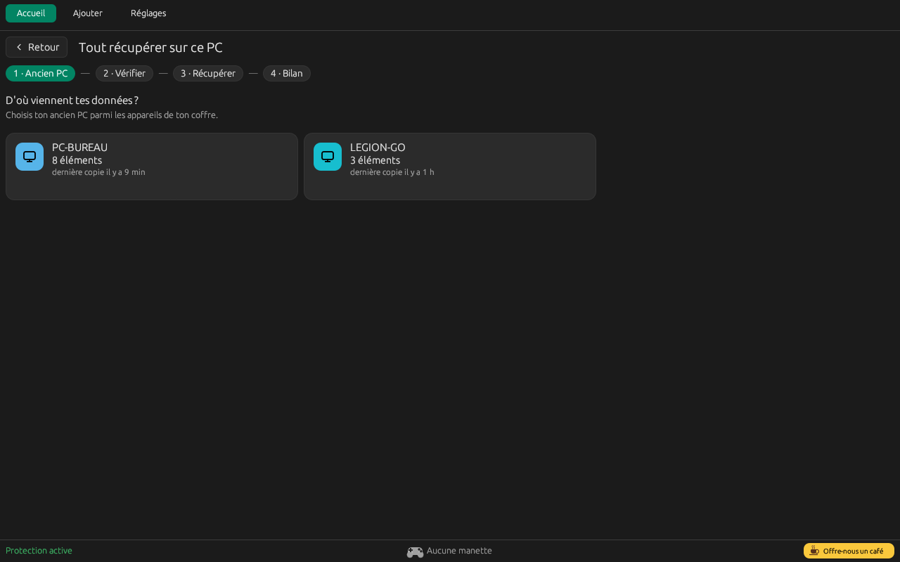 | 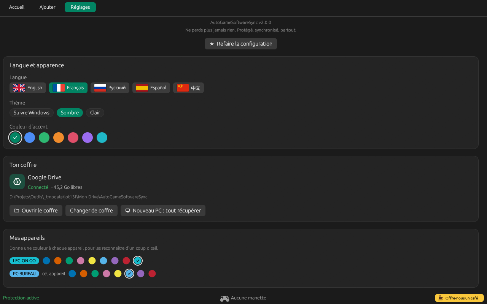 |
| 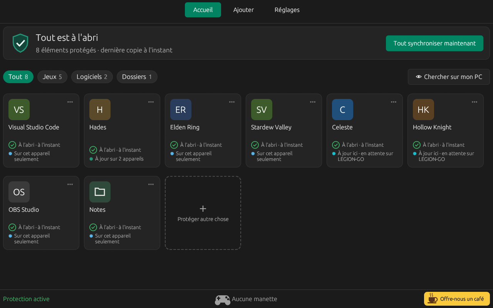 | |

## Utilisation

1. Télécharge l'archive depuis la page [Releases](https://github.com/Epikou/AutoGameSoftwareSync/releases/latest), décompresse-la et place `AutoGameSoftwareSync.exe` dans un dossier permanent (par exemple `C:\Tools\AutoGameSoftwareSync`).
2. Lance-le. Le premier lancement te guide en 6 étapes : la langue, ton coffre, cet appareil, le scan de ton PC, autre chose, et la première copie.
3. Sur tes autres appareils, installe-le de la même façon et choisis le **même coffre** : tes éléments sont retrouvés et remis.

Si ton coffre est sur Google Drive, passe Drive en *Mettre en miroir les fichiers* (ou rends le dossier *disponible hors connexion*), sinon les lectures peuvent être très lentes. L'appli te le signale quand elle détecte le mode « à la demande ».

## Mise à jour depuis la 1.3.x

La 2.0.0 est la première version avec la mise à jour automatique : **installe-la à la main une fois**. Ferme l'ancienne version et remplace `AutoGameSoftwareSync.exe` par le nouveau, dans le même dossier. Tes réglages, tes éléments et ton coffre sont gardés tels quels ; le premier lancement montre « Quoi de neuf en 2.0 » et ne te demande que ce qui est nouveau. Une copie manuelle de ton coffre avant la mise à jour est toujours une bonne idée. Ensuite, les mises à jour se font toutes seules (Réglages > Mises à jour : Automatique / Me demander / Jamais).

## Linux / SteamOS

Une version Linux (x86_64) est aussi disponible : SteamOS (Steam Deck, Legion Go S...), Bazzite et Ubuntu. Télécharge `AutoGameSoftwareSync-v2.0.0-linux-x86_64.tar.gz` depuis la page [Releases](https://github.com/Epikou/AutoGameSoftwareSync/releases/latest), extrais-la et lance `install-linux.sh` (aucun droit administrateur nécessaire). Les copies sont entièrement compatibles avec la version Windows grâce au même coffre, y compris les jeux Windows lancés avec Proton. Guide d'installation : [docs/LINUX.md](docs/LINUX.md).

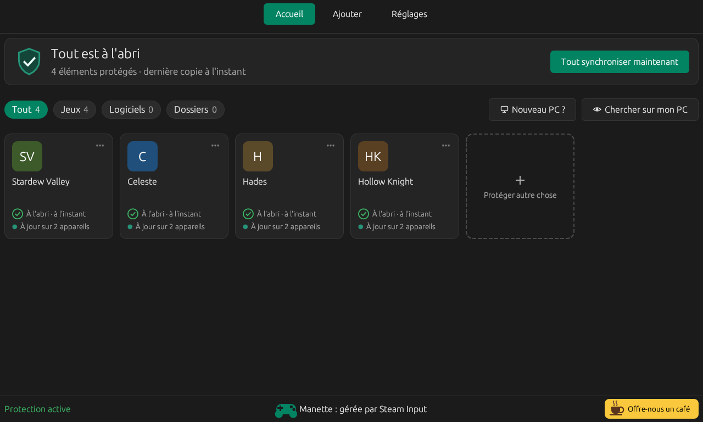

## Alerte Windows SmartScreen

Le programme n'est pas encore signé. Au premier lancement, Windows peut afficher « Windows a protégé votre PC ». Clique sur **Informations complémentaires**, puis **Exécuter quand même**. Cette alerte s'estompe avec le nombre d'utilisateurs.

## Confidentialité

- Tes sauvegardes et réglages vont uniquement dans le coffre que tu choisis.
- **Statistiques d'usage facultatives**, seulement si tu cliques sur « Oui, j'aide » (question au premier lancement et après une mise à jour) : au plus une fois par jour, version, système, langue, fonctions utilisées, erreurs par catégorie, tranches, et les noms des titres connus que tu protèges (base intégrée et profils), avec un identifiant aléatoire renouvelé tous les 13 mois. Jamais : les noms que tu tapes, les fichiers, les chemins, le nom de l'appareil ; l'adresse IP n'est pas conservée. Gardées 90 jours, hébergées chez Cloudflare. Désactivation, « Voir ce qui est envoyé » et « Effacer mes données » dans **Réglages > Données d'usage**.
- Pour un programme inconnu, l'appli peut lancer une recherche web anonyme avec son nom. Elle demande aussi à GitHub si une mise à jour existe et, par défaut, l'installe automatiquement après avoir vérifié la signature de l'auteur (Réglages > Mises à jour : Automatique / Me demander / Jamais).
- Détails : [PRIVACY.md](PRIVACY.md).

## Sécurité

Fais une copie manuelle de tes sauvegardes avant la première utilisation. Le programme est fourni tel quel, sans garantie (voir [TERMS.md](TERMS.md)).

## Limite connue

Le programme ne peut pas remettre une sauvegarde *avant* le démarrage d'un jeu lancé hors d'un lanceur intégré. Une extension Playnite est prévue pour cela.

## À propos de ce projet

AutoGameSoftwareSync est **vibecodé** : je vibe donc je code. J'exerce en tant qu'ingénieur infrastructure réseau et je suis passionné de jeux et d'informatique depuis plus de 40 ans ❤️

Il est fait avec passion plutôt que par une grosse équipe : attends-toi à quelques aspérités (et à un bug de temps en temps qui me fait lever les yeux au ciel). Toute aide, suggestion, signalement de bug ou idée est la bienvenue : ouvre une [issue](https://github.com/Epikou/AutoGameSoftwareSync/issues). Merci d'être là !

## Assistance

Bugs et idées : ouvre une [issue](https://github.com/Epikou/AutoGameSoftwareSync/issues). Si le projet te plaît, tu peux [nous offrir un café](https://ko-fi.com/autogamesoftwaresave).
