  

**English** | [Français](README.fr.md) | [Русский](README.ru.md) | [Español](README.es.md) | [中文](README.zh.md)

  

Your game saves and software settings, protected and synced between all your devices: desktop PC, laptop, handheld (Legion Go S, Steam Deck...). Pick up your game right where you left it, find your software setup wherever you are. Everything goes through **your vault**: any shared folder your devices can all see (Google Drive, OneDrive, Dropbox, Nextcloud, Syncthing, a NAS, a USB drive...). Free and open source (GPL-3.0), Windows and Linux.

[**Download the latest version**](https://github.com/Epikou/AutoGameSoftwareSync/releases/latest) · [**Join the Discord**](https://discord.gg/W8YXUJAK4e) · [Support the project on Ko-fi](https://ko-fi.com/autogamesoftwaresave)

## How it works

  

1. The app runs on each of your devices and watches the games and software you protect.
2. When you stop playing, a copy goes to **your vault**. Each copy is a **new version**: nothing is ever overwritten.
3. On your other devices, the newest version is put back on its own, so you pick up right where you left off.
4. Every version stays in the vault: **go back in time** whenever you want.

## Key features

### Everything at a glance

One tile per game, software or folder, with its state ("Safe · 2 min ago", "Copying… 64 %", "New version from Handheld") and where it is up to date across your devices.

  

### Go back in time

A day-by-day timeline of every version from every device. Bring yesterday's version back in one click, and **undo** if you change your mind: a safety copy is always made first.

  

### It spots your games while you play

Launch a game: the app recognizes it and offers to protect it. One click on **Sync it!** and it joins your home screen. Your command-line tools are never offered.

  

### A first launch that really sets things up

6 short steps (language, vault, this device, scan, anything else, first copy), then everything happens on its own.

  

### New PC: bring everything back

Pick your old device, check, recover. Works across user names and from Windows to Linux; a game not installed yet is recovered as soon as it appears.

  

### And also

- **Your vault is found on its own**: Google Drive, OneDrive, Dropbox, iCloud, MEGA, pCloud, Nextcloud, Syncthing, network and USB drives. A vault you already use (on another device, or from an older version) is offered first.
- **PC scan**: your games (Steam, Epic, GOG, Xbox, Ubisoft, EA, itch, emulators), your software, your personal folders and Windows shortcuts. What is safe is ticked, the rest is suggested; development tools and system programs are never proposed.
- **Automatic, verified updates**: signed by the author, installed at a quiet moment, and the previous version comes back by itself if something goes wrong.
- **Simple by default, expert when you want**: plain words and 6 settings cards; an expert mode keeps every technical option.
- Never loses data: every copy is a new folder, older versions are kept, nothing is ever overwritten in your vault.
- Full gamepad navigation, big-screen mode for handhelds, dark and light themes. Languages: English, Français, Русский, Español, 中文.

## Screenshots

| | |
|---|---|
|  |  |
|  |  |
|  |  |
|  |  |
|  | |

## How to use

1. Download the archive from the [Releases](https://github.com/Epikou/AutoGameSoftwareSync/releases/latest) page, unzip it and put `AutoGameSoftwareSync.exe` in a permanent folder (for example `C:\Tools\AutoGameSoftwareSync`).
2. Run it. The first launch guides you in 6 steps: language, your vault, this device, a scan of your PC, anything else, and the first copy.
3. On your other devices, install it the same way and pick the **same vault**: your items are found and brought back.

If your vault is on Google Drive, set Drive to *Mirror files* (or make the folder *available offline*), otherwise reads can be very slow. The app tells you when it detects the on-demand mode.

## Upgrading from 1.3.x

Version 2.0.0 is the first version with automatic updates, so **install it by hand once**: close the old version and replace `AutoGameSoftwareSync.exe` with the new one, in the same folder. Your settings, your items and your vault are kept as they are; the first launch shows "What's new in 2.0" and only asks what is new. Making a manual copy of your vault before upgrading is always a good idea. From then on, updates install themselves (Settings > Updates: Automatic / Ask me / Never).

## Playnite extension

Using Playnite? The free extension shows on each game page its protection state, the date of the last sync and the device it comes from, in its own colour. It works in fullscreen mode with the most popular themes (Solaris, ReskinPS5, PS5ish...). It reads your saves' state and, with AutoGameSoftwareSync 2.0.3 or newer, sends it the list of your installed Playnite games so the app can suggest the ones not protected yet. It never touches your saves.

**[Download the Playnite extension](https://github.com/Epikou/AutoGameSoftwareSync-Playnite/releases/latest)** · [More about it](https://github.com/Epikou/AutoGameSoftwareSync-Playnite)

## Linux / SteamOS

A Linux build (x86_64) is available too: SteamOS (Steam Deck, Legion Go S...), Bazzite and Ubuntu. Download `AutoGameSoftwareSync-vX.Y.Z-linux-x86_64.tar.gz` from the [Releases](https://github.com/Epikou/AutoGameSoftwareSync/releases/latest) page, extract it and run `install-linux.sh` (no administrator rights needed). Copies are fully compatible with the Windows version through the same vault, including Windows games run with Proton. Installation guide (in French): [docs/LINUX.md](docs/LINUX.md).

## Windows SmartScreen warning

The program is not code-signed yet. At the first launch Windows may show "Windows protected your PC". Click **More info**, then **Run anyway**. This warning disappears as more people use the program.

## Privacy

- Your saves and settings go only to the vault you choose.
- **Optional usage statistics**, only if you click "Yes, I'll help" (asked at first launch and after an update): at most once a day, version, system, language, features used, errors by category, ranges, and the names of the known titles you protect (from the built-in database and profiles), with a random ID renewed every 13 months. Never: names you type, files, paths, device name; the IP address is not kept. Kept 90 days, hosted by Cloudflare. Turn it off, see what is sent or erase your data in **Settings > Usage data**.
- For an unknown program, the app may run an anonymous web search with its name. It also asks GitHub whether an update exists and, by default, installs it automatically after verifying the author's signature (Settings > Updates: Automatic / Ask me / Never).
- Details: [PRIVACY.md](PRIVACY.md).

## Safety

Make a manual copy of your saves before your first use. The program is provided as is, without warranty (see [TERMS.md](TERMS.md)).

## Known limitation

The program cannot bring a save back *before* a game starts when it is launched outside a launcher integration.

## About this project

AutoGameSoftwareSync is **vibe-coded**: I vibe, therefore I code. I work as a network infrastructure engineer and I've been passionate about games and computers for over 40 years ❤️

It is built with passion rather than by a big team, so expect the occasional rough edge (and the occasional bug that makes me facepalm). Any help, suggestion, bug report or idea is warmly welcome: open an [issue](https://github.com/Epikou/AutoGameSoftwareSync/issues). Thank you for being here!

## Support

Questions, help and news: join the [Discord](https://discord.gg/W8YXUJAK4e). Bugs and ideas: open an [issue](https://github.com/Epikou/AutoGameSoftwareSync/issues). If you like the project, you can [buy us a coffee](https://ko-fi.com/autogamesoftwaresave).
