

  

[English](README.md) | [Français](README.fr.md) | **Русский** | [Español](README.es.md) | [中文](README.zh.md)

  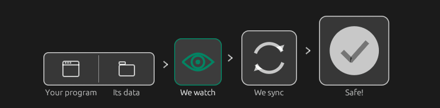

Твои сохранения и настройки игр и программ — под защитой и синхронизированы между всеми твоими устройствами: ПК, ноутбук, портативная консоль (Legion Go S, Steam Deck...). Продолжай игру с того места, где остановился, и находи свои настройки программ, где бы ты ни был. Всё проходит через **твоё хранилище**: любую общую папку, которую видят все твои устройства (Google Drive, OneDrive, Dropbox, Nextcloud, Syncthing, NAS, USB-накопитель...). Бесплатно, с открытым исходным кодом (GPL-3.0), Windows и Linux.

[**Скачать последнюю версию**](https://github.com/Epikou/AutoGameSoftwareSync/releases/latest) · [**Присоединиться к Discord**](https://discord.gg/W8YXUJAK4e) · [Поддержать проект на Ko-fi](https://ko-fi.com/autogamesoftwaresave)

## Как это работает

  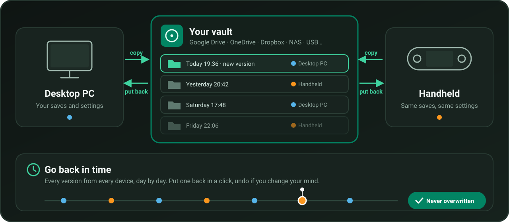

1. Приложение работает на каждом твоём устройстве и следит за играми и программами, которые ты защищаешь.
2. Когда ты заканчиваешь играть, копия отправляется в **твоё хранилище**. Каждая копия — **новая версия**: ничего не перезаписывается.
3. На других устройствах самая свежая версия возвращается сама: продолжаешь с того места, где остановился.
4. Все версии остаются в хранилище: **вернись в прошлое**, когда захочешь.

## Главное

### Всё с первого взгляда

По плитке на каждую игру, программу или папку, с её состоянием («В безопасности · 2 мин назад», «Копирование… 64 %», «Новая версия с Handheld») и с тем, на каких устройствах она актуальна.

  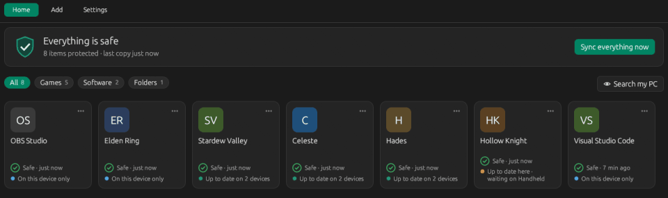

### Вернуться в прошлое

Лента по дням со всеми версиями со всех устройств. Верни вчерашнюю версию одним щелчком и **отмени**, если передумаешь: перед этим всегда делается страховочная копия.

  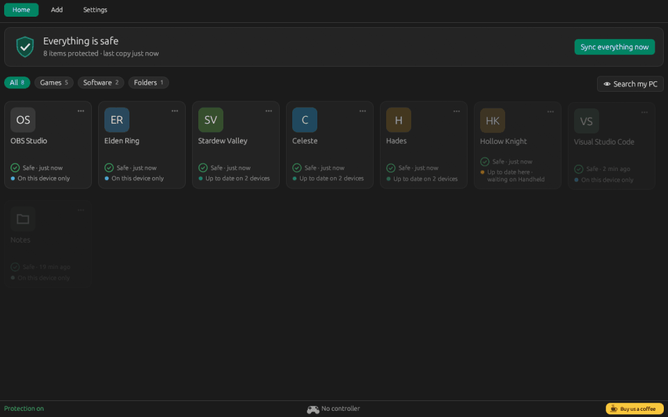

### Замечает игры, когда ты играешь

Запусти игру: приложение узнаёт её и предлагает защитить. Один щелчок по **«Синхронизировать!»** — и она появляется на главном экране. Консольные инструменты никогда не предлагаются.

  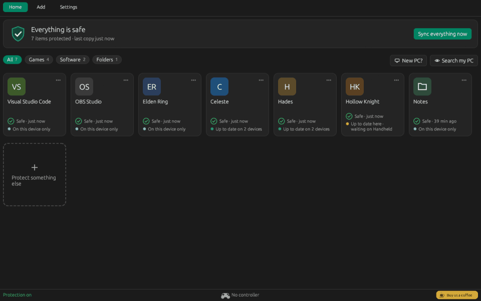

### Первый запуск, который действительно всё настраивает

6 коротких шагов (язык, хранилище, это устройство, поиск, что-то ещё, первая копия), дальше всё идёт само.

  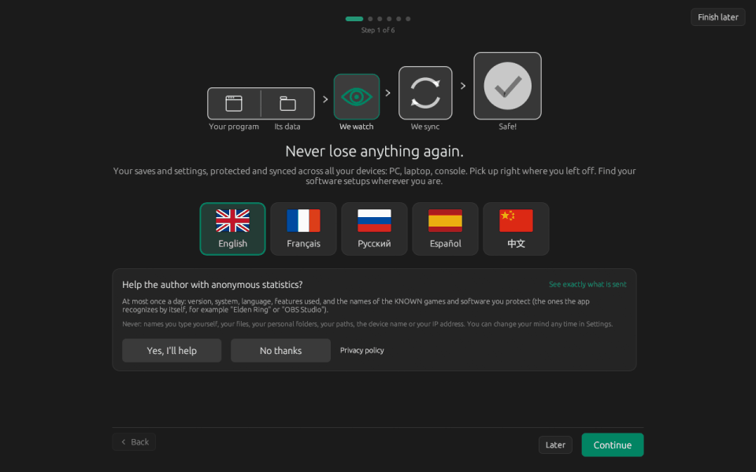

### Новый ПК: вернуть всё

Выбери старое устройство, проверь, верни. Работает с другим именем пользователя и с Windows на Linux; ещё не установленная игра возвращается, как только она появится.

  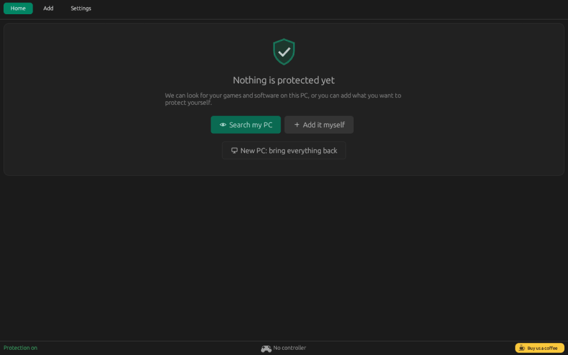

### А также

- **Хранилище находится само**: Google Drive, OneDrive, Dropbox, iCloud, MEGA, pCloud, Nextcloud, Syncthing, сетевые и USB-диски. Хранилище, которым ты уже пользуешься (на другом устройстве или в старой версии), предлагается первым.
- **Поиск по ПК**: твои игры (Steam, Epic, GOG, Xbox, Ubisoft, EA, itch, эмуляторы), программы, личные папки и ярлыки Windows. Надёжное отмечено, остальное предложено; инструменты разработки и системные программы никогда не предлагаются.
- **Автоматические проверенные обновления**: подписаны автором, ставятся в спокойный момент, а прежняя версия возвращается сама, если что-то пошло не так.
- **Просто по умолчанию, режим эксперта по желанию**: понятные слова и 6 карточек настроек; режим эксперта сохраняет все технические параметры.
- Данные никогда не теряются: каждая копия — новая папка, старые версии сохраняются, в хранилище ничего не перезаписывается.
- Полное управление геймпадом, крупный режим для портативных консолей, тёмная и светлая темы. Языки: English, Français, Русский, Español, 中文.

## Скриншоты

| | |
|---|---|
| 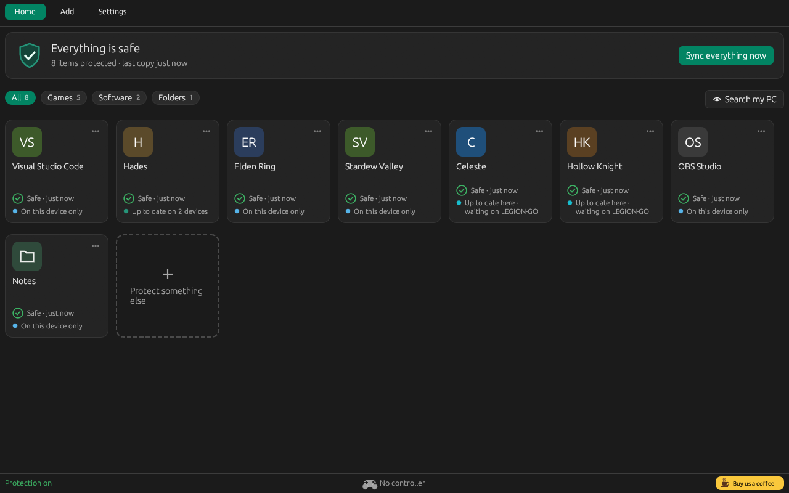 | 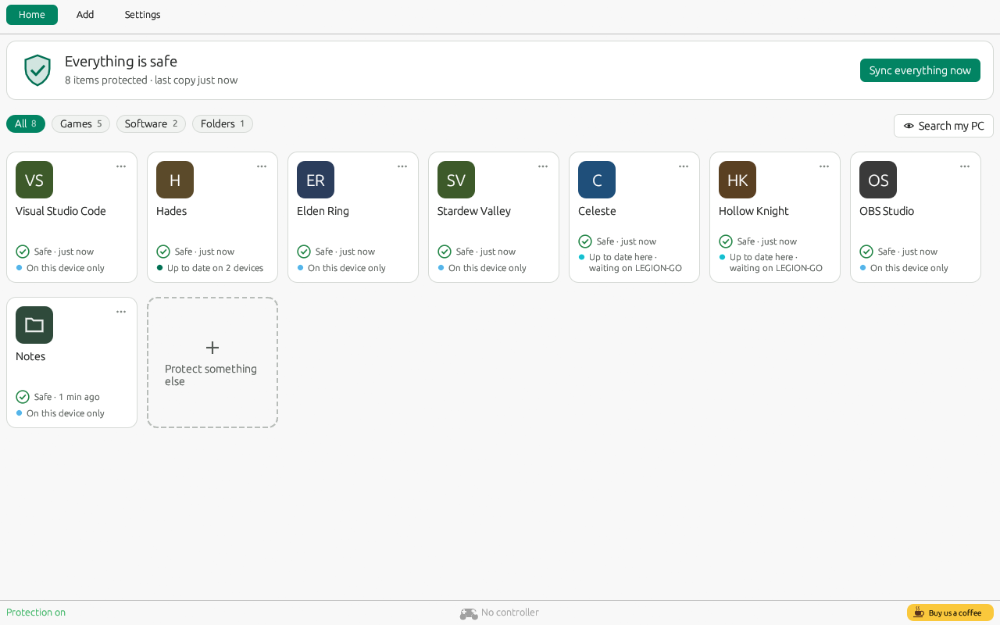 |
| 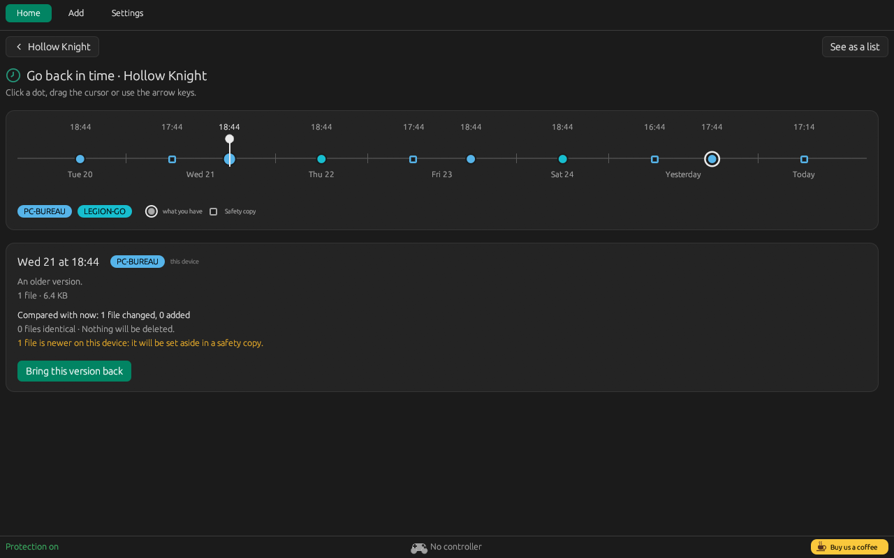 | 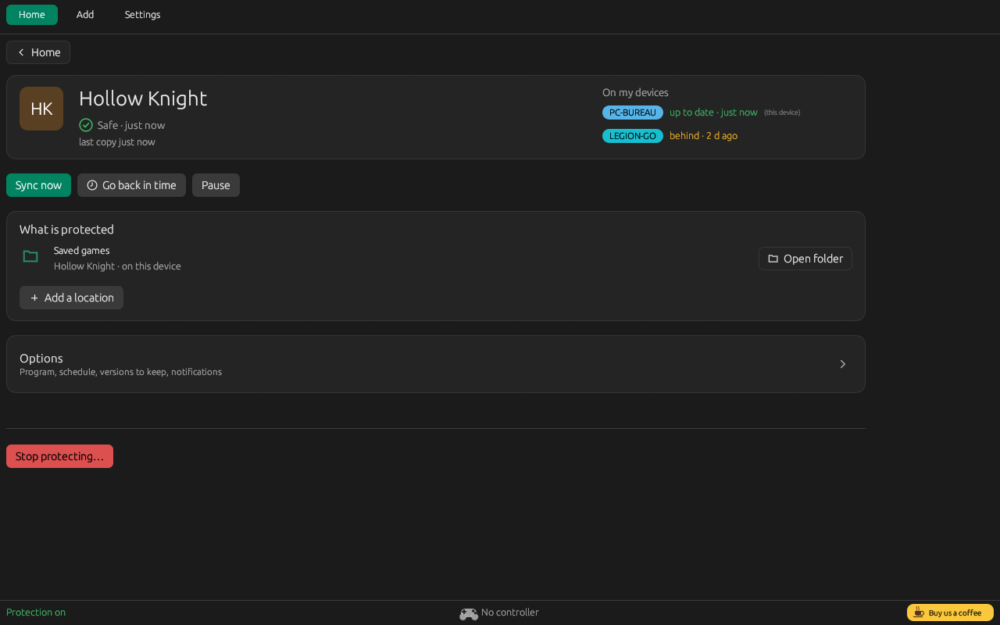 |
| 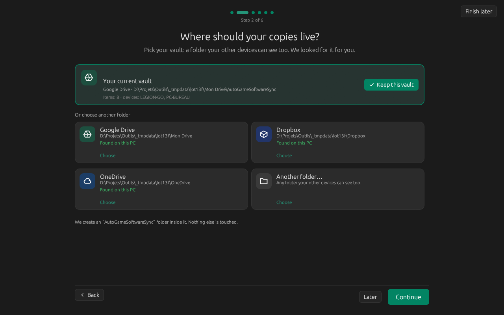 | 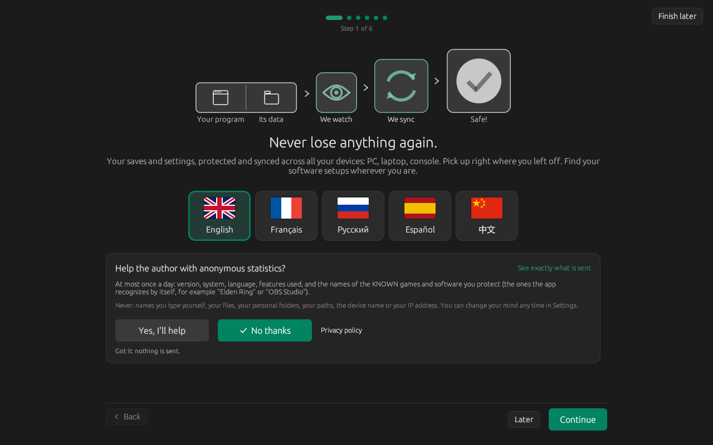 |
| 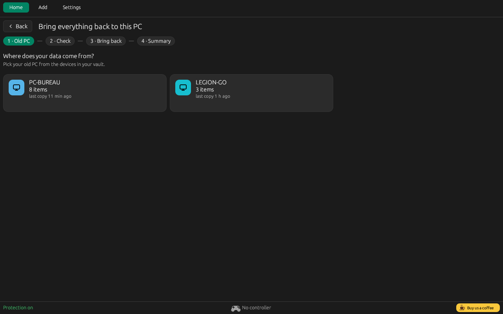 | 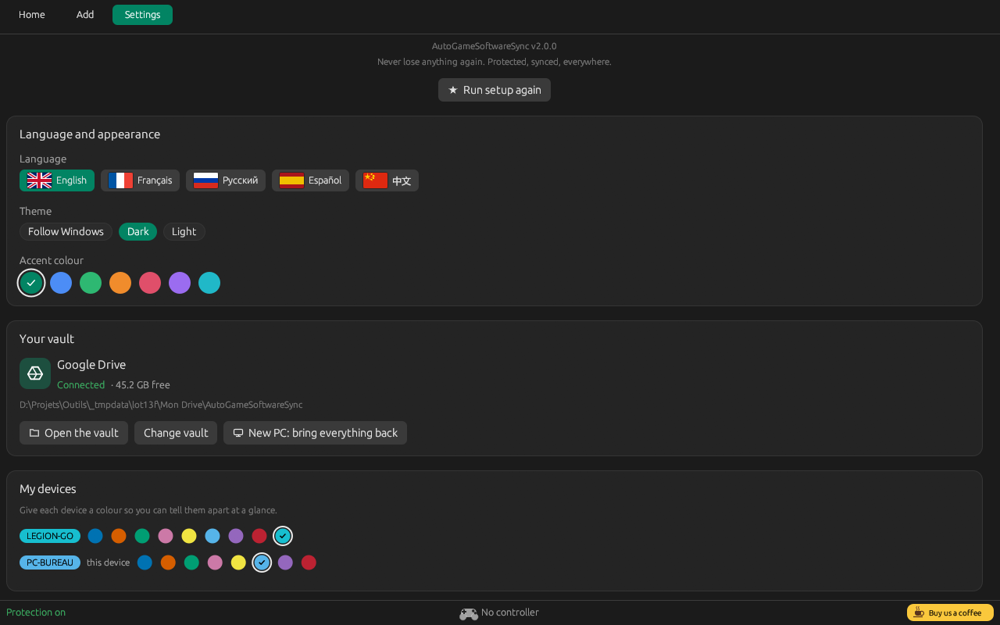 |
| 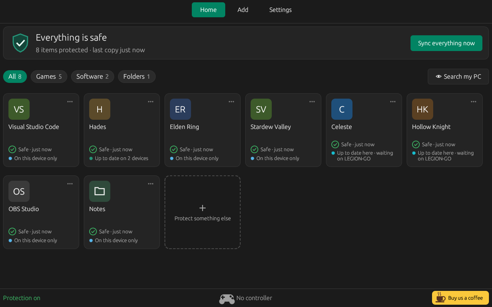 | |

## Как пользоваться

1. Скачай архив со страницы [Releases](https://github.com/Epikou/AutoGameSoftwareSync/releases/latest), распакуй его и положи `AutoGameSoftwareSync.exe` в постоянную папку (например, `C:\Tools\AutoGameSoftwareSync`).
2. Запусти его. Первый запуск проведёт тебя через 6 шагов: язык, хранилище, это устройство, поиск по ПК, что-то ещё и первая копия.
3. На других устройствах установи программу так же и выбери **то же хранилище**: твои элементы будут найдены и возвращены.

Если хранилище находится в Google Drive, включи в Drive режим *Зеркальное копирование файлов* (или сделай папку *доступной офлайн*), иначе чтение может быть очень медленным. Приложение предупредит, если обнаружит режим «по запросу».

## Обновление с версии 1.3.x

2.0.0 — первая версия с автоматическим обновлением, поэтому **установи её вручную один раз**: закрой старую версию и замени `AutoGameSoftwareSync.exe` новым в той же папке. Настройки, элементы и хранилище сохраняются как есть; первый запуск покажет «Что нового в 2.0» и спросит только о новом. Ручная копия хранилища перед обновлением — всегда хорошая идея. Дальше обновления ставятся сами (Настройки > Обновления: Автоматически / Спрашивать / Никогда).

## Расширение для Playnite

Пользуетесь Playnite? Бесплатное расширение показывает на странице каждой игры состояние защиты, дату последней синхронизации и устройство, с которого она пришла, в его цвете. Работает в полноэкранном режиме с самыми популярными темами (Solaris, ReskinPS5, PS5ish...). Оно читает состояние ваших сохранений и, начиная с AutoGameSoftwareSync 2.0.3, передаёт приложению список установленных игр Playnite, чтобы оно предложило ещё не защищённые. Оно никогда не трогает ваши сохранения.

**[Скачать расширение для Playnite](https://github.com/Epikou/AutoGameSoftwareSync-Playnite/releases/latest)** · [Подробнее](https://github.com/Epikou/AutoGameSoftwareSync-Playnite)

## Linux / SteamOS

Доступна и сборка для Linux (x86_64): SteamOS (Steam Deck, Legion Go S...), Bazzite и Ubuntu. Скачай `AutoGameSoftwareSync-vX.Y.Z-linux-x86_64.tar.gz` со страницы [Releases](https://github.com/Epikou/AutoGameSoftwareSync/releases/latest), распакуй архив и запусти `install-linux.sh` (права администратора не нужны). Копии полностью совместимы с версией для Windows через то же хранилище, включая игры Windows под Proton. Руководство по установке (на французском): [docs/LINUX.md](docs/LINUX.md).

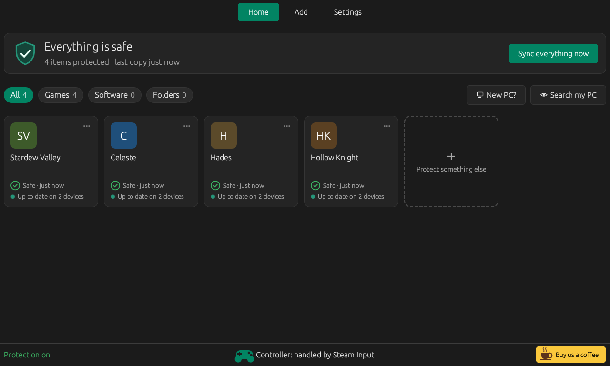

## Предупреждение Windows SmartScreen

Программа пока не имеет цифровой подписи. При первом запуске Windows может показать «Windows защитила ваш компьютер». Нажми **Подробнее**, затем **Выполнить в любом случае**. Это предупреждение исчезает по мере роста числа пользователей.

## Конфиденциальность

- Твои сохранения и настройки попадают только в выбранное тобой хранилище.
- **Необязательная статистика использования**, только если ты нажмёшь «Да, помогу» (вопрос при первом запуске и после обновления): не чаще раза в день — версия, система, язык, используемые функции, ошибки по категориям, диапазоны и названия известных защищаемых тобой программ (из встроенной базы и профилей), со случайным идентификатором, который обновляется каждые 13 месяцев. Никогда: введённые тобой имена, файлы, пути, имя устройства; IP-адрес не сохраняется. Хранится 90 дней на серверах Cloudflare. Отключение, просмотр отправляемого и удаление данных — в **Настройки > Данные использования**.
- Для неизвестной программы приложение может выполнить анонимный веб-поиск по её названию. Оно также проверяет на GitHub наличие обновлений и по умолчанию устанавливает их автоматически после проверки подписи автора (Настройки > Обновления: Автоматически / Спрашивать / Никогда).
- Подробности (на английском и французском): [PRIVACY.md](PRIVACY.md).

## Безопасность

Перед первым использованием сделай ручную копию своих сохранений. Программа предоставляется «как есть», без гарантий (см. [TERMS.md](TERMS.md)).

## Известное ограничение

Программа не может вернуть сохранение *до* запуска игры, если игра запущена вне интегрированного лаунчера.

## О проекте

AutoGameSoftwareSync создан в стиле **vibe-coding**: я вайблю, значит, я кодю. Я работаю инженером по сетевой инфраструктуре и увлекаюсь играми и компьютерами более 40 лет ❤️

Проект сделан с душой, а не большой командой, так что возможны шероховатости (и время от времени баг, от которого я хватаюсь за голову). Любая помощь, предложение, сообщение об ошибке или идея приветствуются: открой [issue](https://github.com/Epikou/AutoGameSoftwareSync/issues). Спасибо, что ты здесь!

## Поддержка

Вопросы, помощь и новости: присоединяйся к [Discord](https://discord.gg/W8YXUJAK4e). Ошибки и идеи: открой [issue](https://github.com/Epikou/AutoGameSoftwareSync/issues). Если проект тебе нравится, можно [угостить нас кофе](https://ko-fi.com/autogamesoftwaresave).

*Перевод выполнен автоматически и может содержать неточности.*
