  

[English](README.md) | [Français](README.fr.md) | [Русский](README.ru.md) | [Español](README.es.md) | **中文**

  

你的游戏和软件存档与设置，受到保护并在你的所有设备之间同步：台式机、笔记本、掌机（Legion Go S、Steam Deck 等）。从上次停下的地方继续游戏，无论身在何处都能找回你的软件配置。一切都通过**你的保险库**完成：任何一个你的设备都能访问的共享文件夹（Google Drive、OneDrive、Dropbox、Nextcloud、Syncthing、NAS、U 盘等）。个人使用免费，支持 Windows 和 Linux。

[**下载最新版本**](https://github.com/Epikou/AutoGameSoftwareSync/releases/latest) · [在 Ko-fi 上支持本项目](https://ko-fi.com/autogamesoftwaresave)

## 工作原理

  

1. 应用在你的每台设备上运行，监视你保护的游戏和软件。
2. 你停止游戏后，一份副本会进入**你的保险库**。每份副本都是一个**新版本**：任何内容都不会被覆盖。
3. 在你的其他设备上，最新版本会自动恢复：从上次停下的地方继续。
4. 所有版本都保留在保险库中：随时都可以**时光倒流**。

## 主要功能

### 一目了然

每个游戏、软件或文件夹一个磁贴，显示它的状态（“已保护 · 2 分钟前”、“正在复制… 64 %”、“来自 Handheld 的新版本”）以及它在哪些设备上是最新的。

  

### 时光倒流

按天排列的时间轴，包含所有设备上的所有版本。一键恢复昨天的版本，改变主意时还能**撤销**：恢复前总会先做一份安全副本。

  

### 在你玩游戏时识别游戏

启动一个游戏：应用会识别它并建议保护它。点击 **“同步！”**，它就会出现在你的首页。命令行工具永远不会被推荐。

  

### 真正完成设置的首次启动

6 个简短步骤（语言、保险库、此设备、扫描、其他内容、首次复制），之后一切自动进行。

  

### 新电脑：找回一切

选择旧设备、检查、找回。支持不同的用户名，也支持从 Windows 到 Linux；尚未安装的游戏会在出现后立即找回。

  

### 此外

- **自动找到你的保险库**：Google Drive、OneDrive、Dropbox、iCloud、MEGA、pCloud、Nextcloud、Syncthing、网络驱动器和 U 盘。你已经在用的保险库（在其他设备上或旧版本中）会被优先推荐。
- **电脑扫描**：你的游戏（Steam、Epic、GOG、Xbox、Ubisoft、EA、itch、模拟器）、软件、个人文件夹和 Windows 快捷方式。可靠的会被勾选，其余的作为建议；开发工具和系统程序永远不会被推荐。
- **自动且经过验证的更新**：由作者签名，在空闲时安装；如果出现问题，旧版本会自动恢复。
- **默认简单，需要时可用专家模式**：通俗的用语和 6 张设置卡片；专家模式保留所有技术选项。
- 永不丢失数据：每次复制都是一个新文件夹，旧版本会被保留，保险库中的内容永远不会被覆盖。
- 完整的手柄操作，掌机大屏模式，深色和浅色主题。语言：English、Français、Русский、Español、中文。

## 截图

| | |
|---|---|
|  |  |
|  |  |
|  |  |
|  |  |
|  | |

## 使用方法

1. 从 [Releases](https://github.com/Epikou/AutoGameSoftwareSync/releases/latest) 页面下载压缩包，解压后把 `AutoGameSoftwareSync.exe` 放到一个固定的文件夹（例如 `C:\Tools\AutoGameSoftwareSync`）。
2. 运行它。首次启动会引导你完成 6 个步骤：语言、你的保险库、此设备、扫描电脑、其他内容和首次复制。
3. 在其他设备上用同样的方式安装，并选择**同一个保险库**：你的项目会被找到并恢复。

如果你的保险库在 Google Drive 上，请把 Drive 设置为*镜像文件*（或让该文件夹*可离线使用*），否则读取可能会非常慢。应用检测到“按需”模式时会提醒你。

## 从 1.3.x 升级

2.0.0 是第一个支持自动更新的版本，因此请**手动安装一次**：关闭旧版本，在同一个文件夹中用新的 `AutoGameSoftwareSync.exe` 替换旧文件。你的设置、项目和保险库都会原样保留；首次启动会显示“2.0 新功能”，只询问新增的内容。升级前手动备份一下保险库总是个好主意。之后更新会自动安装（设置 > 更新：自动 / 询问我 / 从不）。

## Linux / SteamOS

同时提供 Linux 版本（x86_64）：SteamOS（Steam Deck、Legion Go S 等）、Bazzite 和 Ubuntu。请从 [Releases](https://github.com/Epikou/AutoGameSoftwareSync/releases/latest) 页面下载 `AutoGameSoftwareSync-v2.0.0-linux-x86_64.tar.gz`，解压后运行 `install-linux.sh`（无需管理员权限）。通过同一个保险库，副本与 Windows 版完全兼容，包括通过 Proton 运行的 Windows 游戏。安装指南（法语）：[docs/LINUX.md](docs/LINUX.md)。

## Windows SmartScreen 提示

程序目前尚未进行代码签名。首次运行时 Windows 可能显示“Windows 已保护你的电脑”。请点击**更多信息**，然后点击**仍要运行**。随着使用者增多，该提示会逐渐消失。

## 隐私

- 你的存档和设置只会复制到你选择的保险库。
- **可选的使用统计**：仅在你点击“好的，我来帮忙”后才会发送（首次运行和每次更新后询问）。每天最多一次：版本、系统、语言、使用的功能、按类别的错误、数量区间，以及你所保护的已知作品名称（来自内置数据库和配置文件），并附带每 13 个月更新一次的随机标识。绝不发送：你输入的名称、文件、路径、设备名称；不保留 IP 地址。数据保存 90 天，托管于 Cloudflare。可在 **设置 > 使用数据** 中关闭、查看发送的内容或删除你的数据。
- 对于未知程序，应用可能会用其名称进行匿名网络搜索。它还会向 GitHub 查询是否有更新，并默认在验证作者签名后自动安装（设置 > 更新：自动 / 询问我 / 从不）。
- 详情（英文和法文）：[PRIVACY.md](PRIVACY.md)。

## 安全提示

首次使用前请手动备份你的存档。本程序按“现状”提供，不提供任何担保（见 [TERMS.md](TERMS.md)）。

## 已知限制

如果游戏不是通过集成启动器启动，程序无法在游戏启动*之前*恢复存档。计划为此提供 Playnite 扩展。

## 关于这个项目

AutoGameSoftwareSync 是用“氛围编程”（vibe coding）做出来的：我感受氛围，所以我写代码。对游戏和电脑的热爱已经超过 40 年 <3

它出自热情，而不是一个庞大的团队，所以难免有些粗糙的地方（偶尔还有让我扶额的 bug）。欢迎任何帮助、建议、错误报告或想法：请提交 [issue](https://github.com/Epikou/AutoGameSoftwareSync/issues)。感谢你的到来！

## 支持

问题与建议：请提交 [issue](https://github.com/Epikou/AutoGameSoftwareSync/issues)。如果你喜欢这个项目，可以[请我们喝杯咖啡](https://ko-fi.com/autogamesoftwaresave)。

*本译文为自动翻译，可能存在错误。*
